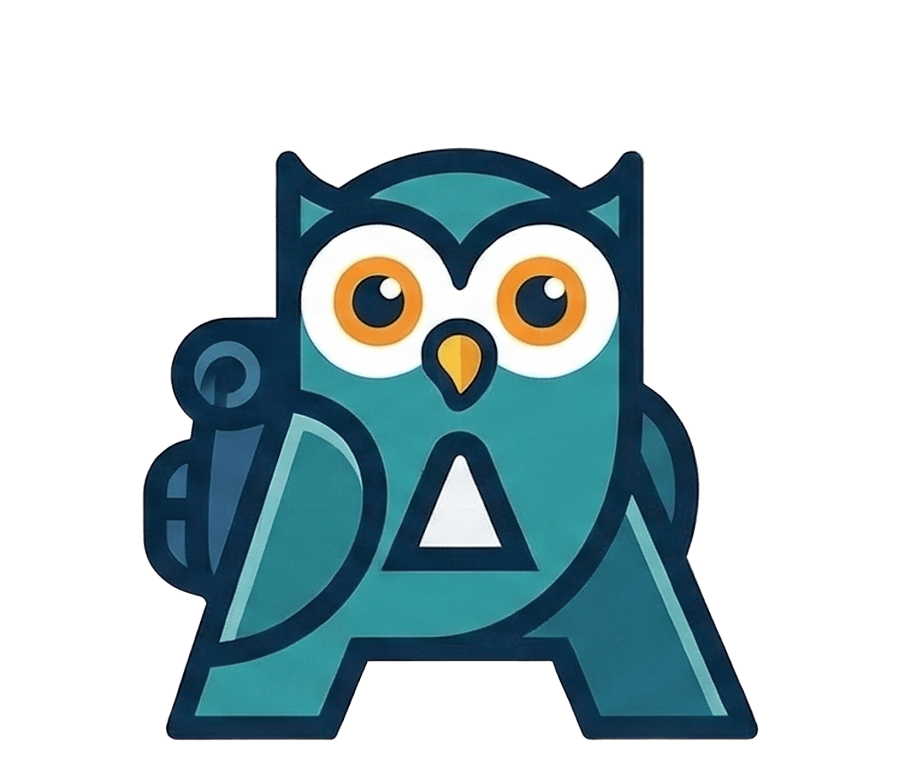

<div align="center">



# Adnin Rais

### Senior Full-Stack Software Engineer

**8 years shipping production software across fintech, e-commerce, healthcare, and enterprise.**

[](https://arraidev.site)
[](https://www.linkedin.com/in/adnin-rais-2976b811a/)
[](mailto:adnin.rais31@gmail.com)
[](https://wa.me/6285715162024)

🟢 **Open to full-stack roles at international companies**

</div>

---

## 👋 Why work with me

I build software that runs real payments, real hospitals, and real factory floors — and I build it to last.

- 💳 **Payments & fintech**: 3D Secure integration with Bank Mandiri, a Wallet-as-a-Service platform for merchants, QRIS Tap payments on **MRT Jakarta**, and the Alfamart and BNI integrations at **Xendit**.
- 🏥 **Mission-critical healthcare**: calendar, queue management, and front-office systems for **Siloam Hospitals**.
- 🛒 **Commerce & ERP from scratch**: custom ERP, POS, and an e-commerce platform with an algorithmic skin recommendation engine at **Base Indonesia**.
- 🏭 **Enterprise low-code**: Power Apps solutions and corporate training for **Toyota** and **Michelin**.
- ⚡ **Performance-minded**: cut test execution time by **50%** by migrating from Jasmine to Jest and testing only modified code paths.
- 🧱 **Clean Architecture advocate**: I keep codebases scalable and maintainable long after launch.

## 📊 At a glance

| 8+ years | 7 companies | 50% faster tests | Shipping since 2017 |
| :---: | :---: | :---: | :---: |
| Full-stack experience | Fintech → healthcare → enterprise | Jasmine → Jest migration | From Xendit to Finnet |

## 🧰 Tech stack

| Area | Tools |
| --- | --- |
| **Frontend** | React, Next.js, Angular, Vue 3, TypeScript, JavaScript, Redux, MobX, Tailwind CSS |
| **Backend** | Node.js, Express.js, NestJS, Golang, Laravel |
| **Database** | PostgreSQL, MySQL, MongoDB |
| **APIs & Integration** | REST, GraphQL, RabbitMQ, WhatsApp API, Intercom |
| **DevOps & Testing** | Docker, Git, CI/CD, Jest, Selenium, Mocha, Webpack |
| **Cloud** | Vercel, AWS, GCP, Firebase |
| **Power Platform** | Power Apps, Power Automate, Dataverse, SharePoint, Teams |

## 💼 Career

| Period | Role | Company |
| --- | --- | --- |
| Apr 2026 – Present | Fullstack Engineer | **Finnet Indonesia** |
| Jul 2025 – Apr 2026 | Senior Fullstack Engineer | **Siloam Hospital** |
| Jul 2025 – Feb 2026 | Power Apps Developer & Corporate Trainer (Freelance) | **Toyota** |
| Jan 2025 – Jul 2026 | Power Apps Developer (Freelance) | **Michelin** |
| Apr 2020 – Jul 2025 | Senior Fullstack Engineer | **Base Indonesia** |
| Oct 2018 – Mar 2020 | Frontend Developer | **Style Theory** |
| Nov 2017 – Sep 2018 | Software Engineer | **Xendit** |

👉 Full details on **[arraidev.site](https://arraidev.site)**.

---

## 🖥️ About this repository

This is the source code for my personal portfolio at **[arraidev.site](https://arraidev.site)**: a dark, single-page site with an amber accent.

**Features**
- Bold hero section with a profile card and key stats
- Scroll-reveal animations that respect `prefers-reduced-motion`
- Floating dock navigation that highlights the active section
- Career timeline and skill cards
- Responsive from mobile to desktop

**Built with**: React 18, Tailwind CSS, Font Awesome, and Google Fonts (Unbounded, Inter, JetBrains Mono).

### Run locally

```bash
git clone https://github.com/adnin31/main-web.git
cd main-web
npm install
npm start
```

Then open [http://localhost:3000](http://localhost:3000).

### Build for production

```bash
npm run build
```

The optimized output is written to `build/`.

### Project structure

```
src/
├── App.js               # Page layout
├── index.css            # Global styles, grid texture, animations
└── components/
    ├── Hero.jsx         # Name, intro, CTAs, profile card
    ├── Skills.jsx       # Skill cards
    ├── Experience.jsx   # Career timeline
    ├── Footer.jsx       # Contact section
    ├── Dock.jsx         # Floating bottom navigation
    └── ui.jsx           # Shared bits: Reveal, Chip, SectionTitle
```

To update your own content, edit the data arrays at the top of `Skills.jsx` and `Experience.jsx`.

---

<div align="center">

**Let's build something great.**
📧 [adnin.rais31@gmail.com](mailto:adnin.rais31@gmail.com) · 💼 [LinkedIn](https://www.linkedin.com/in/adnin-rais-2976b811a/) · 🐙 [GitHub](https://github.com/adnin31)

</div>
